# QeMCMC: quantum proposals for portfolio sampling

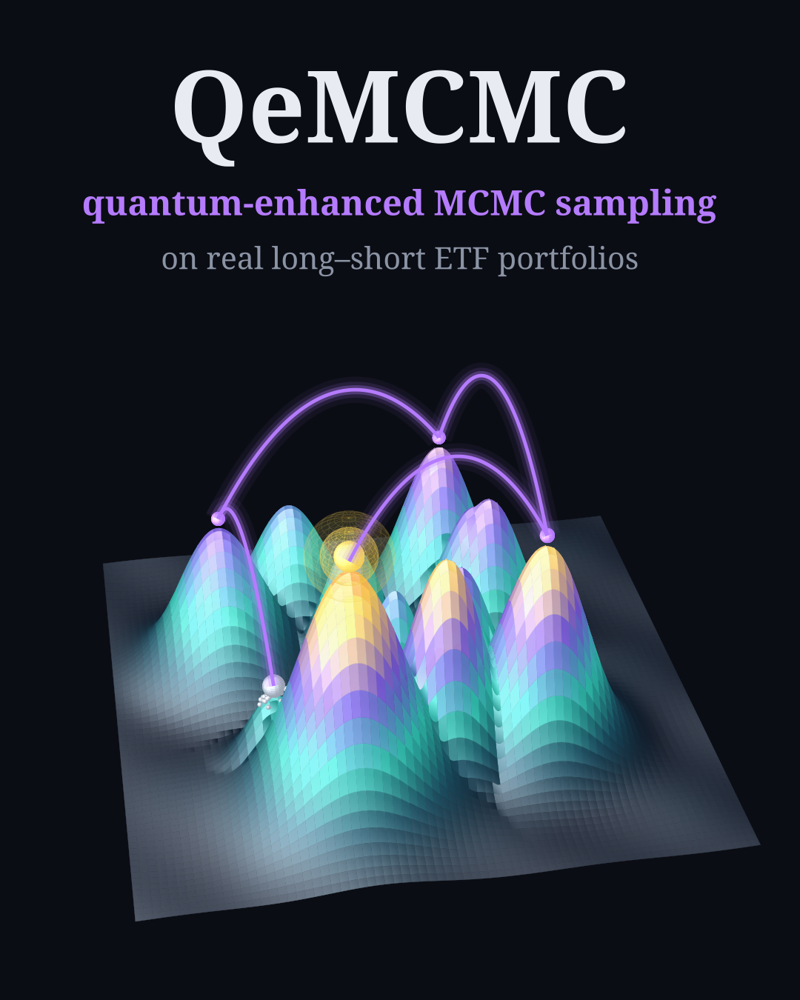

Can a quantum circuit propose better moves for a Markov chain Monte Carlo (MCMC) search
than classical swap moves, on a real financial problem where the right answer is known?

This repository holds the code, data and results from our IBM Quantum hackathon project
(Qiskit Fall Fest, USC, November 2026). We compare **quantum-enhanced MCMC (QeMCMC)**,
where each proposal comes from a count-preserving XY-mixer circuit with a score phase,
against classical Metropolis with swap moves. All problem sizes are small enough to
enumerate every portfolio, so every number is measured against an exact answer key.

**Team (Bose's Fan Club):** Marcus Sostak, Aigar Boltyenkov, Jesus Garcia.

<br clear="right">

## Results in brief

**1. The textbook problem is too easy.** Choosing k of n ETFs by mean–variance score gives
a single-peaked landscape in all 64 quarterly windows (2010–2025), because the common
market factor makes most ETFs move together.

**2. A market-neutral long–short book is rugged.** Hold all n assets at equal size, half long and half short, and minimize risk.
Correlated assets want opposite sides, which cannot hold for every pair. On real ETFs at
8 long / 8 short, the median window has 13 local optima.

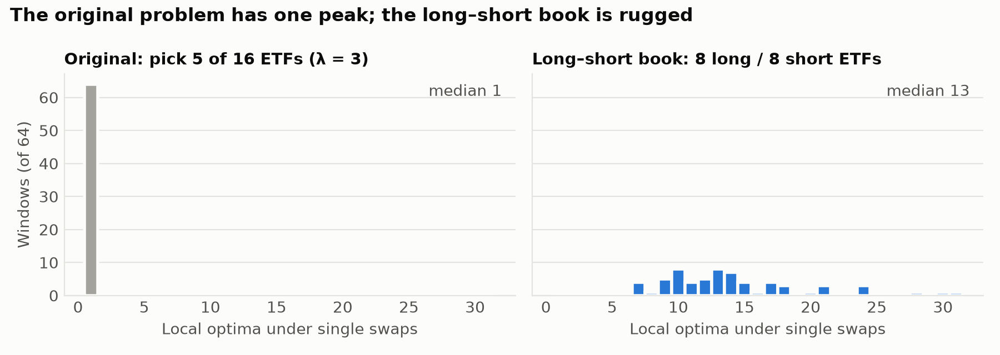

**3. In simulation, the quantum proposal samples faster.** With a complete XY mixer and
the full score phase, the exact spectral gap beats tuned multi-swap Metropolis in 81%
(ETFs) and 91% (stocks) of held-out windows. Each method gets one setting tuned on
the other 32 windows. A phase-off control shows that the gain comes from the score
information in the circuit, not from longer jumps.

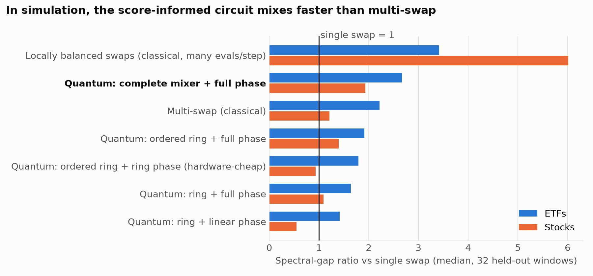

**4. It does not find the best book faster.** Plain single-swap Metropolis reaches the
optimum in the fewest attempts. Long jumps help a chain move between peaks, but near
the top they are usually rejected.

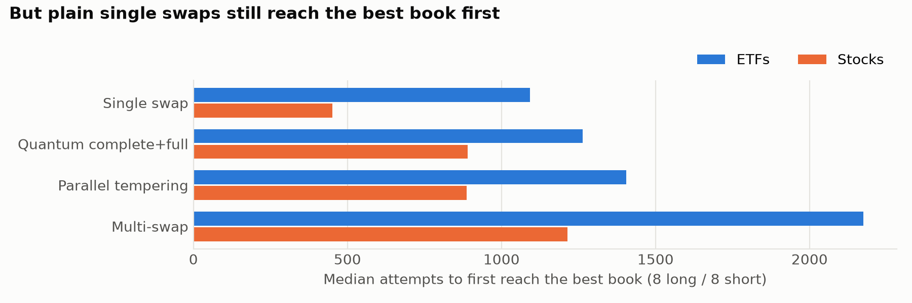

**5. On IBM hardware the gain disappears.** The winning circuit needs about 540 two-qubit
gates. A cheaper 86-gate circuit ran on `ibm_marrakesh` (12 QPU-seconds). Only 43% of
shots kept the right count, and the chain mixed slower than single swap, though it
still settled close to the target distribution.

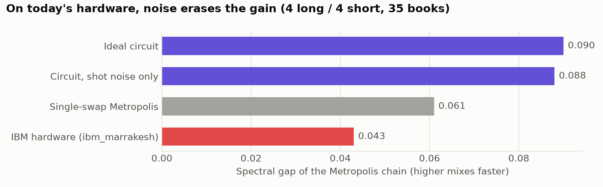

We claim a sampling result in simulation only. We do not claim a quantum speedup or better
investment performance. Full numbers, methods and caveats are in
[`research_results.md`](research_results.md).

## Quick start

Developed and tested on Python 3.14.

```bash
git clone https://github.com/Marcuss2106/ibm-qiskit-usc-2026.git
cd ibm-qiskit-usc-2026
python -m venv qiskit-env && source qiskit-env/bin/activate
pip install -r requirements.txt
python -m pytest -q tests            # offline, synthetic data
```

Price data and the derived windows (`data/`) and all result tables (`results/`) are
committed, so you can inspect the results without downloading anything.

### Reproduce the main results

```bash
python -m qemcmc.data                                       # prices -> data/instances.npz (--refresh re-downloads)
python -m qemcmc.objective                                  # answer key for the original problem
python -m qemcmc.landscape                                  # local optima for the original problem
python -m qemcmc.longshort                                  # long–short landscape and gaps, 6/6
PYTHONPATH=. python experiments/longshort/fair_tuning.py    # main result: train/test, one setting per method
PYTHONPATH=. python experiments/longshort/phase_control.py  # score phase off vs on
PYTHONPATH=. python experiments/longshort/race.py           # attempts to reach the best book
PYTHONPATH=. python experiments/longshort/compile_depth.py  # transpiled two-qubit gate counts
python -m qemcmc.hardware dry --backend fake_fez            # noisy hardware simulation, no account needed
```

### Running on IBM Quantum hardware (optional)

Copy `.env.example` to `.env`, fill in your IBM Quantum API key and instance CRN, and save
the account once:

```bash
cp .env.example .env      # then edit .env
python run_once.py
python -m qemcmc.hardware full --backend ibm_marrakesh --shots 1024   # about 12 QPU-seconds
python -m qemcmc.hardware analyze results/hardware/<file>.json
```

Never commit `.env`; it is git-ignored.

## How it works

**The search is a loop.** Start from a book (a portfolio), propose a new one, then accept
or reject it with the classical Metropolis rule. QeMCMC changes only the proposal step:
a quantum circuit proposes the next book instead of a random swap.

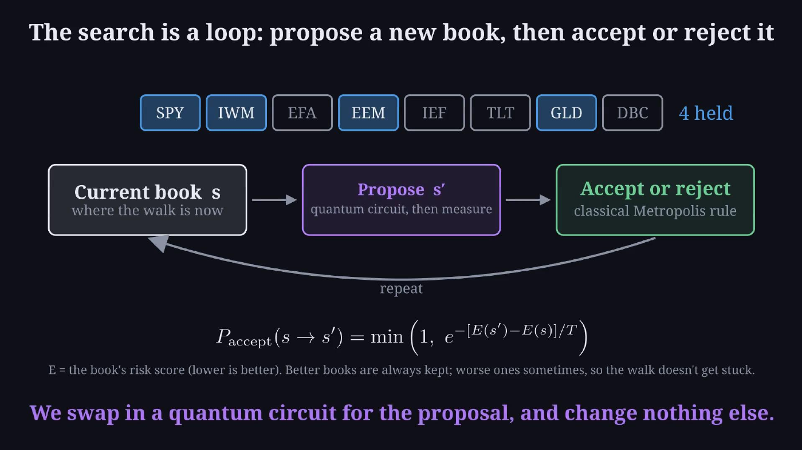

**Long-short books have many peaks.** Long-only portfolios have one peak, so any search
climbs straight to it. In a long–short book, ETFs that move together want opposite
sides, which makes the problem a max-cut on the correlation graph. Every triangle of
correlated ETFs leaves one pair on the same side, and that tension creates many competing
good books.

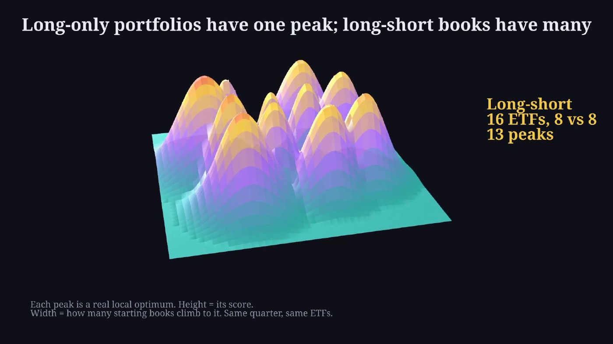

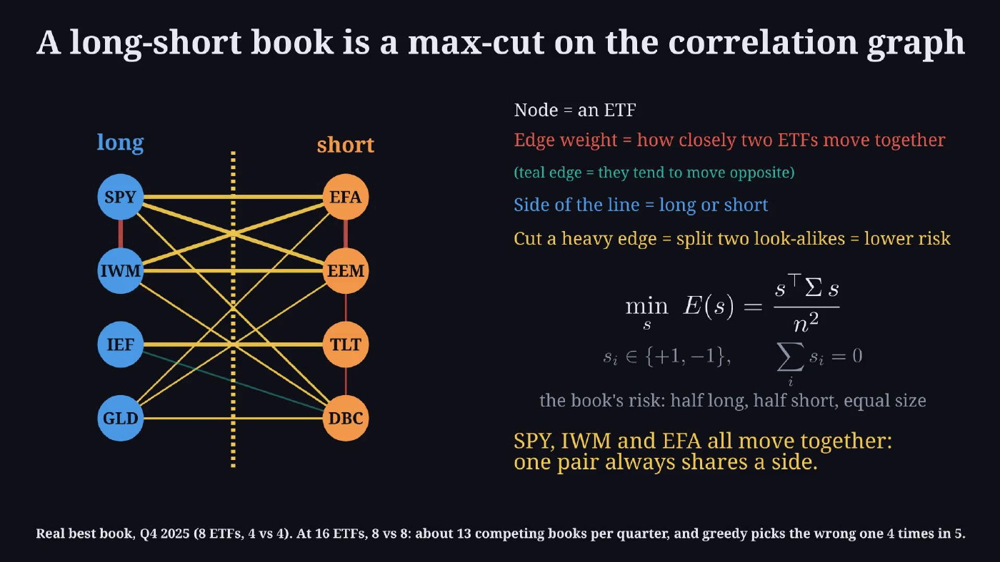

**The quantum move keeps the count fixed and steers by score.** One qubit per asset. An
XY mixer M(β) tries many long-for-short trades at once, a phase P(γ) stamps each book with
its score, and the reversed mixer recombines them before measurement. Every gate
preserves the number of longs, and because the circuit is a palindrome the proposal
table is symmetric, so plain Metropolis acceptance stays exact.

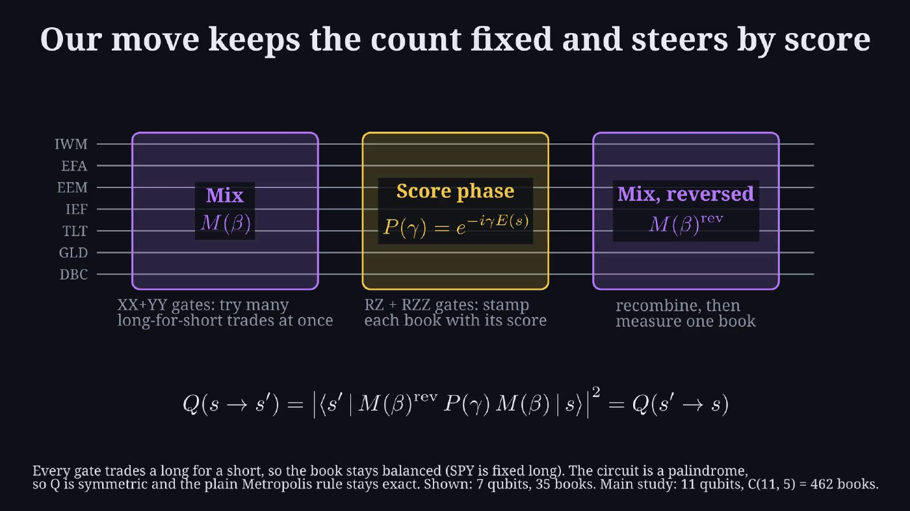

**What the move looks like.** A single swap can only reach next-door books, all equally
likely. The quantum move also reaches far-off books, weighted by their scores.

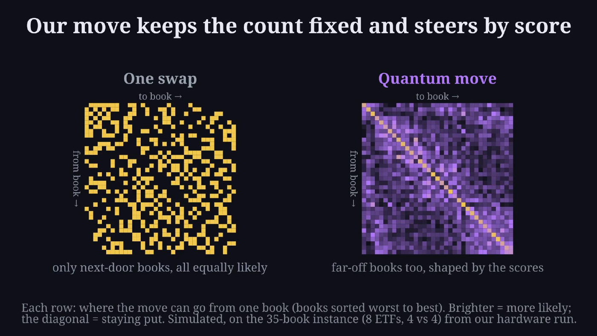

**Exact analysis.** `qemcmc/subspace.py` simulates only the valid books, so a full
proposal table at 4,368 states takes about 1 s instead of about 350 s by statevector.
Every method's exact spectral gap then comes from its transition matrix.

## Repository layout

| Path | Contents |
|---|---|
| `qemcmc/` | Library: data (`data.py`), portfolio numbering (`states.py`), scores (`objective.py`, `longshort.py`), landscapes and gaps (`landscape.py`, `gaps.py`, `dial.py`), Qiskit circuits (`circuits.py`), fast simulator (`subspace.py`), hardware pipeline (`hardware.py`), negative pilots (`factors.py`, `hedgebook.py`) |
| `experiments/` | One study per folder, each with a README: `landscape`, `dial`, `factor_pilot`, `hedgebook`, `longshort` (main result), `hardware` |
| `results/` | CSV outputs and raw hardware counts (`results/hardware/`) |
| `data/` | Cached adjusted daily closes and the 64 quarterly windows |
| `tests/` | Offline tests: proposal symmetry, count preservation, simulator vs Qiskit |
| `presentation/` | Five-minute manim talk: video, PDF, HTML slideshow, source |
| `docs/` | Development guide, scope, literature review, references, README charts (`docs/figures/`, built by `make_figures.py`) and slide stills (`docs/media/`) |
| `research_results.md` | Full write-up of the results |
| `*.ipynb` | Hackathon starter notebooks |

Developers and coding agents should start with [`docs/DEVELOPMENT.md`](docs/DEVELOPMENT.md).

## Presentation

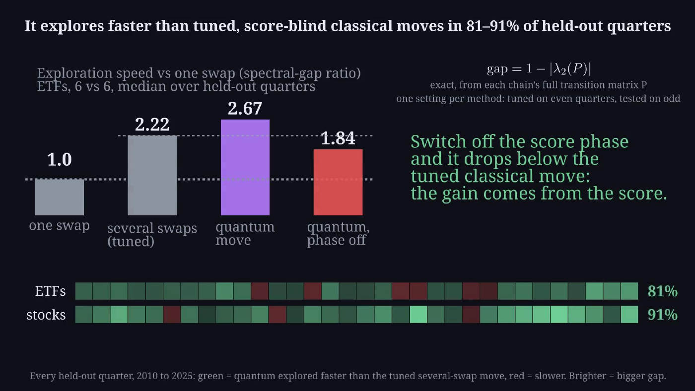

- Video: [`presentation/full_talk.mp4`](presentation/full_talk.mp4)
- Slides (PDF): [`presentation/full_talk.pdf`](presentation/full_talk.pdf)
- Build instructions: [`presentation/README.md`](presentation/README.md)

## Key references

- Layden, Mazzola, Mishmash, Motta et al. (2023). Quantum-enhanced Markov chain Monte
  Carlo. *Nature* 619, 282–287.
  [doi:10.1038/s41586-023-06095-4](https://doi.org/10.1038/s41586-023-06095-4)
- Kawamata, Nakano & Fujii (2026). Divide-and-conquer neural-network surrogates for
  quantum sampling: accelerating MCMC in large-scale constrained optimization.
  *Phys. Rev. Applied*. Closest prior work. [doi:10.1103/qprn-rs96](https://doi.org/10.1103/qprn-rs96)
- Orfi & Sels (2024). Bounding the speedup of the quantum-enhanced Markov-chain Monte
  Carlo algorithm. *Phys. Rev. A* 110, 052414.
  [doi:10.1103/PhysRevA.110.052414](https://doi.org/10.1103/PhysRevA.110.052414)
- Galluccio, Bouchaud & Potters (1998). Rational decisions, random matrices and spin
  glasses. *Physica A*.
  [doi:10.1016/S0378-4371(98)00332-X](https://doi.org/10.1016/S0378-4371(98)00332-X)

The full annotated list with DOIs is in
[`docs/research/references.md`](docs/research/references.md).

## Data and disclaimer

Prices are adjusted daily closes from Yahoo Finance via `yfinance`, included for research
reproducibility. Check Yahoo's terms before reusing them. This is a research benchmark of
search efficiency on a fixed objective, not investment advice.

`get-started-with-qiskit-fallfest-USC.ipynb` is the event's starter material from IBM's
Qiskit in Classrooms modules.

## License

[MIT](LICENSE).
